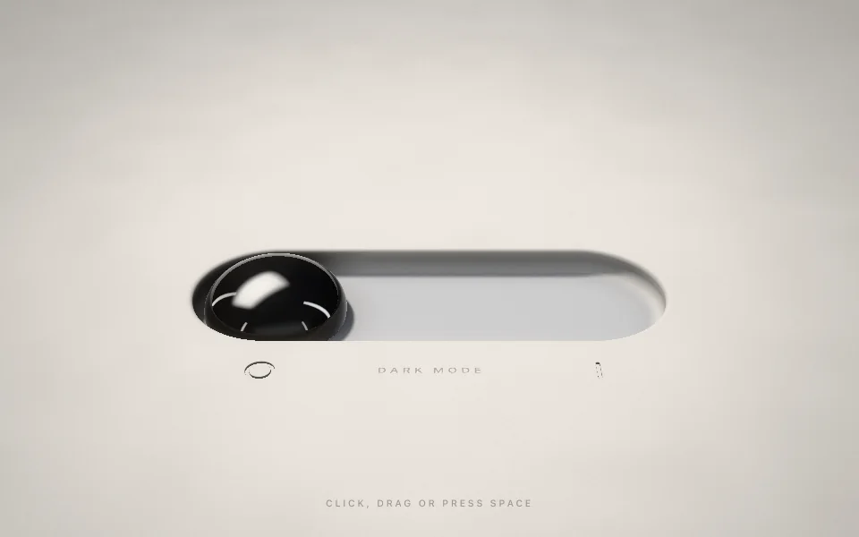

# ferro toggle, made with claude opus 5.5

a ferrofluid dark mode switch that claude opus 5.5 made in one html file

**[try it live](https://argofowl.github.io/ferro-toggle/)**

people asked if this is really html only

it is. one [`index.html`](index.html), about 64 kb, no libraries, no build step, nothing loaded from outside

the liquid is drawn by webgl 2 shaders on one canvas, and the sound is made in the browser too

## controls

- click, drag or press space
- `m` mutes the sound
- add `?hq` to the url for full resolution

## run it

download `index.html` and open it in a browser with webgl 2

that's the whole install

## license

[mit](LICENSE)
