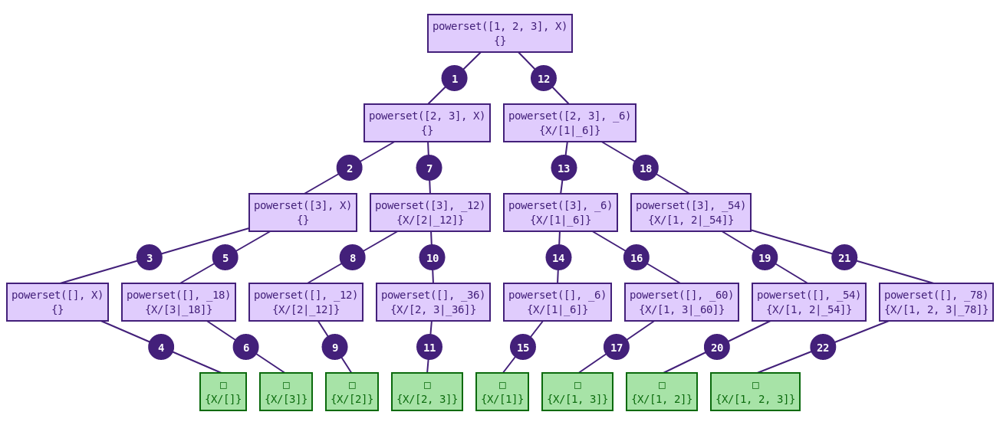

# Drawing derivation trees

## Installation

Include the script [draw-derivation-trees.js](draw-derivation-trees.js) in your web page, after the [core.js](https://github.com/tau-prolog/tau-prolog) script.

```html
<script type="text/javascript" src="tau-prolog/core.js"></script>
<script type="text/javascript" src="tau-prolog/draw-derivation-trees.js"></script>
```

## Usage

This tool adds a new method `draw(max_answers, canvas, styles, options)` to the `pl.type.Session` and `pl.type.Thread` prototypes. This method must be called after querying a goal (with the method `query( goal )`).

- **max_answers**: maximum number of answers to find in the derivation (to avoid infinite trees).
- **canvas**: identifier of the canvas HTML object, or canvas object.
- **styles** (optional): JavaScript object with style properties. The default styles are shown below. When a theme is used, these values override the theme.
- **options** (optional): an object with the following properties:
  - **theme**: name of a theme. The file `themes/<name>.json` is loaded asynchronously and used as the base style. When a theme is requested, `draw` returns a Promise that resolves once the tree has been drawn.
  - **themePath**: directory used to resolve theme files (default `themes/`). `themeUrl` may be used instead to provide a complete URL template (`{name}` is replaced by the theme name).
  - **themes**: optional map of preloaded theme objects, keyed by theme name. Useful when `fetch`/`XMLHttpRequest` is not available.
  - **onThemeError**: function called as `onThemeError( error, themeName, url )` when a theme cannot be loaded or parsed. The tree is still drawn with the built-in default styles (merged with any explicit `styles`), so an error never prevents rendering.

```js
{
  "font-size": 14,
  "font-family": "Monospace, Courier New",
  "border-width": 2,
  "border-color": "#43207a",
  "padding": 5,
  "margin-x": 10,
  "margin-y": 20,
  order: {
    "radius": 15,
    "background-color": "#43207a",
    "border-width": 4,
    "border-color": "#43207a",
    "font-color": "#ffffff"
  },
  state: {
    "background-color": "#e0ccfd",
    "border-width": 4,
    "border-color": "#43207a",
    "font-color": "#43207a"
  },
  answer: {
    "background-color": "#a7e3a7",
    "border-width": 4,
    "border-color": "#0b6a0d",
    "font-color": "#0b6a0d"
  },
  error: {
    "background-color": "#ecc2c2",
    "border-width": 4,
    "border-color": "#881717",
    "font-color": "#881717"
  }
}

```

### Themes

A theme is a JSON object with the same shape as `styles`. The files in the
[themes](themes) directory are ready to use:

```js
session.draw( 10, "derivation", {}, { theme: "monokai" } ).then( function() {
  // The tree has been drawn with themes/monokai.json
} );
```

A missing theme file or malformed JSON does not interrupt drawing: the tree
falls back to the built-in default styles, and `options.onThemeError` is
invoked if provided.

### High-DPI displays

The canvas backing store is sized from `window.devicePixelRatio` (1 when not
available) and the drawing context is scaled accordingly, while
`canvas.style` keeps the CSS dimensions calculated by the layout. Text and
lines therefore stay sharp on retina/high-density screens, and the PNG
exported by clicking the canvas keeps the full backing-store resolution.
Calling `draw` again after the device pixel ratio changes uses the new ratio.

## Example

```html
<html>
  <head>
    <script type="text/javascript" src="tau-prolog/core.js"></script>
    <script type="text/javascript" src="tau-prolog/utils/draw-derivation-trees.js"></script>
    <script id="program.pl" type="text/prolog">
        powerset([], []).
        powerset([_|T], P) :- powerset(T, P).
        powerset([H|T], [H|P]) :- powerset(T, P).
    </script>
  </head>
  <body>
    <canvas id="derivation"></canvas>
    <script type="text/javascript">
        var session = pl.create();
        session.consult( "program.pl" );
        session.query( "powerset([1,2,3], X)." );
        session.draw( 10, "derivation" );
    </script>
  </body>
</html>
```



A complete, runnable theme sample (with a vendored `core.js` and a
`themes/monokai.json` file) is available in
[examples/theme-sample](examples/theme-sample). Serve the repository over HTTP
(for example `npx http-server .`) and open
`examples/theme-sample/index.html`; themes are fetched relative to the page.
