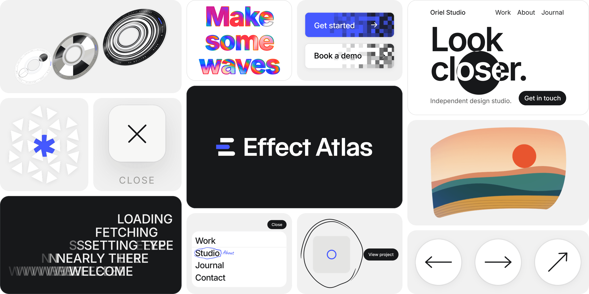

[English](README.md) | 简体中文



# Effect Atlas

<!-- catalog-summary:start -->
50 个前端动效，原生 JavaScript 编写，写给你的 AI，让它搭进你的网站。
<!-- catalog-summary:end -->

[浏览网站](https://effectatlas.com/zh/) · [效果目录](effects/README.zh-CN.md) · [AI 接入指南](docs/ai-integration.zh-CN.md)

## 选一个效果，交给你的 AI

1. 在[网站](https://effectatlas.com/zh/)或[分类目录](effects/README.zh-CN.md)找到需要的效果。
2. 从 `effects/` 复制它的完整文件夹，打开其中的 `index.html` 即可本地体验。
3. 把文件夹和你的页面一起交给 AI，说明需要应用的位置和调整内容。

```text
把 effects/fluid-mask-hero/ 里的效果加到我网站的首屏。
先读 effect.js 开头的说明，并查看 index.html 的接入方式。
适配我现有的内容和布局，保留版权注释。
```

每个文件夹都能独立运行，也可以直接从本地文件打开。使用效果不需要安装依赖或构建。[接入细节与常见问题 →](docs/ai-integration.zh-CN.md)

## 仓库导航

| 位置 | 用途 |
| --- | --- |
| [effects/](effects/README.zh-CN.md) | 分类目录，以及可以独立复制的效果文件夹。 |
| [catalog.json](catalog.json) | 供 AI 和工具检索的名称、介绍、分类、入口文件、挂载函数和依赖索引。 |
| [docs/ai-integration.zh-CN.md](docs/ai-integration.zh-CN.md) | 如何把效果交给 AI、挂载到页面，以及接入现有框架。 |
| [CONTRIBUTING.md](CONTRIBUTING.md) | 问题反馈和维护约定。 |
| [scripts/catalog.mjs](scripts/catalog.mjs) | 校验目录、检查文档链接并生成中英文效果目录。 |

## 每个效果里有什么

```text
effects/<slug>/
  index.html    可以运行的示例，包含挂载调用
  effect.js     效果实现和写给 AI 的接入说明
  effect.css    效果样式
```

弧面画廊、圆盘轮播和长按迸发还带有 `three.min.js` 和对应许可证。复制效果时保留它附带的资源和许可证文件。每个效果的完整文件清单与挂载函数都可在 [catalog.json](catalog.json) 中查询。

## 维护仓库

使用 Node.js 22 或更新版本运行 `node scripts/catalog.mjs --check`，校验索引、文档本地链接和生成目录。修改索引内容后，运行 `node scripts/catalog.mjs --write` 更新中英文目录，再执行检查。单独使用效果不需要运行这些工具。

## 许可协议

源码公开，采用 [Effect Atlas License 1.0](LICENSE) 发布，基于 MIT 许可证和 Commons Clause 改写。它不是 MIT 许可证。

每个效果都可以免费使用，用在你自己的项目里、用在客户项目里都可以，也欢迎分享。不能做的是单独售卖。

- 保留代码开头的版权注释。欢迎注明出自 Effect Atlas，但不是必须的。
- 不得整体或大部分复制 effectatlas.com 或本仓库。在 GitHub 上 fork 本仓库没有问题；把 fork 发布成网站或软件包，就算作复制。
- 代码按原样提供，不提供担保。
- three.js 仍沿用它自己的 MIT 许可证，见旁边的 `three.LICENSE.txt`。批注菜单内嵌了 Caveat 字体的一个子集（SIL Open Font License 1.1，Copyright 2014 The Caveat Project Authors），许可证见 `effects/annotated-menu/Caveat.LICENSE.txt`。

完整协议：[LICENSE](LICENSE)，或 [effectatlas.com/zh/license](https://effectatlas.com/zh/license)。协议保留英文原文，不作翻译；本节中文仅为方便阅读，以英文版为准。

## 联系方式

[hello@effectatlas.com](mailto:hello@effectatlas.com)

Copyright (c) 2026 PROJECT Y/O

## 友情链接

- [LINUX DO](https://linux.do)：感谢社区对我在 AI 学习上的帮助。
